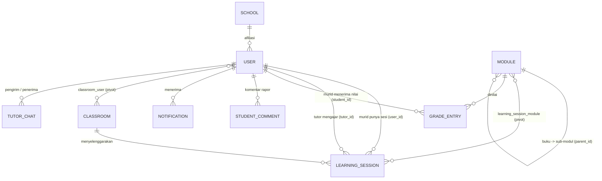

# AICI Learning Platform

Platform manajemen pembelajaran robotika & coding untuk AICI. Dipakai untuk mengelola **murid, tutor, kelas, modul, jadwal & presensi, penilaian, komentar rapor, dan laporan PDF**.

Aplikasi ini **monolith Laravel + React** yang dihubungkan dengan **Inertia.js**. Tidak ada REST API terpisah untuk halaman utama: controller Laravel langsung me-render komponen React.

> Dokumen ini ditulis untuk anak PKL / developer berikutnya. Baca dari atas ke bawah satu kali, lalu pakai sebagai referensi.

---

## 1. Tech Stack

| Bagian | Teknologi |
|---|---|
| Backend | PHP ^8.3, Laravel ^13.8 |
| Frontend | React 18 + TypeScript, Vite 8, Tailwind CSS 3 (via PostCSS), Headless UI, Bootstrap Icons |
| Penghubung | Inertia.js 2 (`inertiajs/inertia-laravel` + `@inertiajs/react`), Ziggy (`@routes` di Blade) |
| Database | MySQL (database `aici`). Default config Laravel = SQLite, tapi `.env` memakai MySQL |
| Session / Cache / Queue | Semuanya driver `database` |
| Auth | Session login (Laravel Breeze-style) + Sanctum untuk `routes/api.php` |
| Library lain | PhpSpreadsheet, Recharts (grafik), html2pdf.js (rapor PDF di browser), JSZip |
| AI | Google Gemini (chatbot FAQ) |
| Test | PHPUnit 12 (SQLite in-memory) |

---

## 2. Menjalankan Project (Lokal)

Prasyarat: PHP 8.3+, Composer, Node.js LTS terbaru (Vite 8 butuh Node versi baru), MySQL.

```bash
# 1. Install dependency
composer install
npm install

# 2. Siapkan environment
cp .env.example .env
php artisan key:generate
# Edit .env: DB_DATABASE, DB_USERNAME, DB_PASSWORD, dll. (lihat bagian 10)

# 3. Buat database kosong bernama "aici" di MySQL, lalu:
php artisan migrate
php artisan db:seed              # hanya membuat akun Super Admin
php artisan storage:link         # WAJIB, supaya avatar/foto kelas/surat libur tampil

# 4. Jalankan
composer dev
```

`composer dev` menjalankan 4 proses sekaligus: `php artisan serve`, `queue:listen`, `pail` (log), dan `npm run dev` (Vite).
Buka `http://localhost:8000`.

Perintah penting lain:

```bash
npm run build          # tsc (type-check) + vite build -> public/build
composer test          # php artisan test
php artisan migrate:fresh --seed   # reset database (HATI-HATI, menghapus semua data)
```

### Data awal (seeder)

`php artisan db:seed` **hanya** menjalankan `SuperAdminSeeder` (akun `admin@aici.id`, password lihat file seeder; **ganti setelah login pertama**).

Seeder lain tidak otomatis jalan. Jalankan manual bila perlu:

```bash
php artisan db:seed --class=CommentTemplateSeeder   # WAJIB agar fitur "generate komentar" berfungsi
php artisan db:seed --class=ReportPeriodSeeder      # periode rapor (pertemuan 1-4, dst.)
php artisan db:seed --class=TutorSeeder
php artisan db:seed --class=ClassroomSeeder
php artisan db:seed --class=BookModulesSeeder       # contoh buku/modul
```

Seeder lainnya (`LearningSessionSeeder`, `AiraGradeEntrySeeder`, `RaporSeeder`, `MultiMeetingGradeSeeder`, `HolidayAnnouncementSeeder`, `TutorChatAndNoteSeeder`, `Clear/EmptyClassroomSeeder`) adalah data dummy / utilitas untuk development. Baca isinya sebelum dijalankan.

---

## 3. Peran Pengguna (Role)

Kolom `users.role` bernilai salah satu dari tiga:

| Role | Sebutan di UI | Halaman utama | Kemampuan utama |
|---|---|---|---|
| `user` | Siswa / murid | `/beranda` | Lihat jadwal, modul, nilai/rapor, profil, unduh PDF profil |
| `tutor` | Tutor / pengajar | `/tutor` | Presensi, input nilai, komentar rapor, lihat modul, kalender mengajar |
| `superadmin` | Super Admin | `/superadmin` | Semuanya: kelola tutor, murid, kelas, kalender, modul, periode rapor, pengumuman |

Status akun (`users.status`): `aktif`, `pending`, `nonaktif`. **Hanya `aktif` yang bisa login/masuk.** Akun non-aktif otomatis di-logout oleh middleware `active`.

**Tidak ada registrasi mandiri.** Semua akun dibuat oleh Super Admin (form manual atau impor CSV). Variabel `AICI_ALLOW_PUBLIC_REGISTRATION`, `AICI_REGISTRATION_CODE`, `AICI_NEW_USER_DEFAULT_STATUS` ada di `.env.example`, tetapi saat dokumen ini ditulis **tidak dipakai oleh kode manapun**.

### Alur login

1. `GET /login` -> `AuthenticatedSessionController@create` -> render `Auth/Login`.
2. `POST /login` -> `LoginRequest::authenticate()`. Jika status bukan `aktif`, langsung logout + pesan error.
3. Redirect sesuai role: `tutor` -> `/tutor`, `superadmin` -> `/superadmin`, lainnya -> `/beranda`.
4. `GET /dashboard` juga hanya redirector berdasarkan role.

### Middleware (alias di `bootstrap/app.php`)

| Alias | File | Fungsi |
|---|---|---|
| `role:a,b` | `RoleMiddleware` | Batasi akses berdasarkan role. Jika salah role, redirect ke dashboard role-nya + pesan error |
| `active` | `EnsureUserIsActive` | Logout paksa akun `pending`/`nonaktif` |
| `guest` | `RedirectIfAuthenticated` | Halaman khusus tamu (login, lupa password) |
| `check.resource` | `CheckResourceAccess` | Didefinisikan, tapi belum terlihat dipakai di route manapun |

`HandleInertiaRequests` ditambahkan ke grup `web` dan membagikan data ke **semua** halaman React (lihat bagian 6).

---

## 4. Struktur Folder

```
project_aici/
├── app/
│   ├── Console/Commands/        # Artisan command kustom (reminder, prune chat, dll.)
│   ├── Http/
│   │   ├── Controllers/
│   │   │   ├── Auth/            # Login, reset password, verifikasi email
│   │   │   ├── SuperAdmin/      # Controller khusus Super Admin
│   │   │   ├── Tutor/           # Controller khusus Tutor (juga bisa diakses Super Admin)
│   │   │   ├── Api/             # Controller untuk routes/api.php (Sanctum)
│   │   │   └── *.php            # Chatbot, Export, Profile, Notification, TutorChat, dll.
│   │   ├── Middleware/
│   │   └── Requests/            # Form Request (validasi) per role
│   ├── Jobs/SendScheduleReminders.php
│   ├── Mail/                    # ResetPasswordMail, ScheduleReminderMail
│   ├── Models/                  # Eloquent model
│   ├── Observers/ActivityObserver.php   # Catat audit log
│   ├── Policies/NotificationPolicy.php
│   ├── Providers/AppServiceProvider.php # Daftarkan observer, paksa HTTPS di production
│   └── Services/                # Logika bisnis besar (impor CSV, StudentLock, pengumuman)
├── bootstrap/app.php            # Routing, alias middleware, config exception
├── config/                      # Config Laravel (config/services.php berisi Gemini)
├── database/
│   ├── migrations/              # Skema DB (urut berdasarkan tanggal)
│   └── seeders/
├── public/
│   ├── build/                   # Hasil `npm run build` (di-ignore git)
│   └── images/                  # Logo + gambar landing page
├── resources/
│   ├── css/app.css
│   ├── js/                      # <-- SELURUH FRONTEND REACT (bagian 6)
│   └── views/app.blade.php      # Satu-satunya template Blade (root Inertia)
├── routes/
│   ├── web.php                  # Semua halaman & endpoint utama
│   ├── auth.php                 # Route autentikasi
│   ├── api.php                  # API ber-token (Sanctum)
│   └── console.php              # Jadwal scheduler
├── storage/app/public/          # Upload: avatar, foto kelas, surat libur (PDF)
├── tests/Feature/               # Test fitur (16 file)
├── dcd.mmd, dfd_*.mmd           # Diagram ERD & DFD (Mermaid)
└── vite.config.js, tailwind.config.js, tsconfig.json
```

### Berkas di root yang bukan bagian aplikasi

`compare_images.html`, `inspect_image.html`, `temp_aici.html` (kosong), `crop_*.png`, `user_gap_screenshot.png`, `initial_user_problem.txt`, `user_original_*.txt`, `original_*.txt` adalah sisa berkas kerja/dokumentasi awal. Tidak dipakai aplikasi saat runtime. Sebaiknya dipindah ke folder `docs/` atau dihapus setelah dicek.
Diagram `dcd.mmd` (ERD) dan `dfd_*.mmd` (DFD level 0 & 2) berguna, simpan di `docs/`. Bisa dilihat di https://mermaid.live.

---

## 5. Backend (Laravel)

### 5.1 Model & relasi utama



| Model | Catatan penting |
|---|---|
| `User` | Satu tabel untuk 3 role. `tutor_id` = tutor pembimbing murid. `classroom_id` = kelas utama, `classrooms()` = semua kelas (pivot `classroom_user`). `syncClassrooms()` menjaga keduanya sinkron. **Soft delete**: saat dihapus email diberi akhiran `.deleted.<timestamp>` agar email bisa dipakai ulang; saat restore akhiran dibuang |
| `Classroom` | Kelas. `tutor_id` = wali kelas. Punya banyak murid & sesi |
| `LearningSession` | Satu baris = **satu murid di satu pertemuan**. `status`: `akan-datang`, `hadir`, `absen`, `libur`. Modul lewat pivot `learning_session_module` (`syncModules()`) |
| `Module` | **Hirarki 2 level**: buku induk (`parent_id` null) -> sub-modul. `module_type`: `robot`, `coding`, `general`. Kolom `tools` (JSON) = alat & bahan |
| `GradeEntry` | Nilai per murid per pertemuan. **Skala 0-5** (`GradeEntry::MAX_SCORE`). Rata-rata (`average`) dihitung **otomatis** di event `saving` |
| `StudentComment` | Komentar rapor per murid per periode (`semester` format `YYYY-MM`, `meeting_range` mis. `1-4`) |
| `CommentTemplate` | Template komentar otomatis berdasarkan rentang nilai |
| `ReportPeriod` | Definisi periode rapor: `start_meeting` - `end_meeting` |
| `School` | Data sekolah mitra |
| `Notification` | Notifikasi in-app (reminder jadwal, dll.) |
| `TutorChat` | Chat Super Admin <-> Tutor (otomatis dihapus setelah 5 hari) |
| `ActivityLog` | Audit log. Diisi otomatis oleh `ActivityObserver` untuk model `User`, `Module`, `GradeEntry`, `LearningSession`, `StudentComment` |

Hampir semua model utama memakai **SoftDeletes**. Data "terhapus" masih ada di DB (`deleted_at`).

### 5.2 Penilaian (GradeEntry)

Kategori nilai: `fokus`, `robot_building`, `tools_management`, `interaksi`, `coding` (masing-masing 0-5).
`robot_building` hanya ikut dirata-rata jika `module_type = robot`. Rata-rata dibulatkan 2 desimal.

### 5.3 Komentar rapor otomatis

`Tutor\CommentController@generate`:
1. Ambil semua `GradeEntry` murid pada bulan/tahun `semester` (`YYYY-MM`).
2. Hitung rata-rata -> tentukan rentang template: `5`, `4-4.99`, atau `<4`.
3. `CommentTemplate::getTemplateForAverage()` memilih template aktif secara acak (prioritas kategori `umum`).
4. Placeholder `{modules}`, `{average}`, `{student}` diganti, lalu disimpan lewat `updateOrCreate` (satu komentar per murid per semester).

> Label "AI-generated" di UI **bukan** Gemini. Ini murni berbasis template. Jika tabel `comment_templates` kosong, hasilnya kosong + pesan error.

### 5.4 Mencegah bentrok antar tutor: `StudentLock`

`app/Services/StudentLock.php` + hook React `useStudentLock`.
- Semua tutor aktif boleh membuka semua murid (kolaboratif/tutor pengganti), tapi **hanya satu tutor yang boleh mengedit satu murid pada satu waktu**.
- Lock disimpan di **cache** (driver `database`), kunci `student_lock:{id}`, TTL 300 detik.
- Frontend memanggil `GET /tutor/lock/{id}` saat halaman dibuka, `POST .../heartbeat` berkala (sekitar 2 menit), dan `POST .../release` saat halaman ditutup.
- Controller yang menulis data memanggil `StudentLock::assertWritable()` -> jika murid sedang dikunci tutor lain, server membalas **HTTP 423**. Super Admin selalu bypass.

### 5.5 Impor massal (CSV)

Service di `app/Services/*BulkImportService.php`. Delimiter `,` atau `;` dideteksi otomatis. Tiap fitur punya **template CSV** yang bisa diunduh dari UI.

| Fitur | Route (Super Admin) | Kolom template |
|---|---|---|
| Murid | `POST /superadmin/students/import-excel` | Nama Lengkap, Email, Password, Kelas, Modul, Sub Modul, Jadwal, Tutor |
| Tutor | `POST /superadmin/tutors/import-excel` | Nama Tutor*, Email*, Password, Status (aktif/nonaktif) |
| Modul | `POST /superadmin/modules/import-csv` | Nama Modul, Buku Induk, Tipe, Urutan, Deskripsi, URL Gambar, Alat dan Bahan |
| Kalender | `POST /superadmin/calendar/import-csv` | Tanggal, Status, Judul Pertemuan, Modul, Email Murid, Tutor, Catatan |

> Walau nama route `import-excel`, yang di-parse adalah **CSV**. Hasil impor (sukses/gagal/peringatan) dikirim balik lewat flash `csv_errors` & `csv_warnings`. Password default pada template tutor tertera di header template. **Ganti password default sebelum production.**

### 5.6 Penjadwalan & presensi

- **Super Admin** menjadwalkan sesi lewat kalender (`/superadmin/calendar/...`) atau massal untuk satu kelas (`POST /superadmin/classes/{classroom}/schedule-session`, membuat satu `LearningSession` per murid). Tutor penanggung jawab dipilih berurutan: `override_tutor_id` -> `tutor_id` murid -> `tutor_id` wali kelas.
- **Tutor** di kalender (`/tutor/calendar/{studentId?}`) hanya boleh **mengubah status kehadiran** (`hadir/absen/libur/akan-datang`). Menambah jadwal (`POST /tutor/calendar`) ditolak 403 kecuali Super Admin.
- **Presensi per kelas** (`/tutor/classes/{classroom}/attendance-form` dan `.../attendance`): tutor mengisi hadir/absen seluruh murid di satu kelas untuk satu pertemuan. Server membuat satu `LearningSession` per murid dalam satu transaksi.
- Route `/tutor/sessions` (CRUD sesi) juga masih ada untuk `tutor` & `superadmin`. Cek `Tutor\SessionController` jika ingin merapikan tumpang-tindih dengan kalender.

### 5.7 Fitur pendukung

| Fitur | Lokasi | Catatan |
|---|---|---|
| Notifikasi in-app | `NotificationController`, `/notifications`, `/api/notifications/*` | Unread count, mark read, hapus |
| Chat Super Admin <-> Tutor | `TutorChatController`, `/api/tutor-chats*` | Widget: `AdminTutorChatWidget`, `TutorLiveChatBanner`, `TutorReadChatsModal` |
| Pengumuman libur | `SuperAdmin\HolidayAnnouncementController` + `HolidayAnnouncementService` | Disimpan sebagai **file JSON** di storage (bukan tabel DB), bisa menyertakan surat PDF. Target: `all`/`user`/`tutor`. Tampil di semua halaman lewat shared prop `holidayAnnouncement` |
| Periode rapor | `SuperAdmin\ReportPeriodController` | Menentukan opsi rentang pertemuan di halaman komentar & rapor PDF |
| Export CSV | `ExportController` | Murid, tutor (Super Admin); nilai & komentar per murid (tutor) |
| Rapor / profil PDF | `ProfileController@pdf`, `StudentGradeReportController` | Backend hanya mengirim data ke halaman `User/ProfilPDF`; **PDF dibuat di browser** dengan `html2pdf.js` |
| Chatbot FAQ | `ChatbotController`, `POST /api/chatbot` | Lihat bawah |

### 5.8 Chatbot (Gemini)

- Frontend: `resources/js/lib/gemini.ts` -> `POST /api/chatbot` (route di `web.php`, pakai session + `throttle:15,1`).
- Backend memanggil Gemini **hanya jika**: `GEMINI_API_KEY` terisi **dan** user login **dan** email terverifikasi. Selain itu dijawab **fallback berbasis kata kunci** (`getFallbackResponse`) agar biaya API tidak bocor ke publik.
- Config di `config/services.php` (`gemini.*`): model default `gemini-1.5-flash`, temperature 0.7, max token 200.

### 5.9 Background job & scheduler

Didefinisikan di `routes/console.php`:

| Jadwal | Command | Fungsi |
|---|---|---|
| Tiap jam | `reminders:send-schedule` | Dispatch job `SendScheduleReminders`: cari sesi `akan-datang` dalam 24 jam ke depan, kirim email (`ScheduleReminderMail`) + buat `Notification` bertipe `schedule_reminder` (tidak dobel) |
| Tiap jam | `chats:prune --hours=120` | Hapus `TutorChat` lebih dari 5 hari |

Agar berjalan di server:
- Cron: `* * * * * cd /path/project && php artisan schedule:run >> /dev/null 2>&1`
- Queue worker: `php artisan queue:work` (queue pakai database)
- Email baru benar-benar terkirim jika `MAIL_MAILER` bukan `log` (di `.env` lokal saat ini `log`, email hanya ditulis ke `storage/logs`).

Command lain: `FixSessionModules` (perbaikan data modul pada sesi). Baca isinya sebelum dijalankan.

### 5.10 REST API (Sanctum): `routes/api.php`

Prefix `/api`, butuh token `auth:sanctum`. Dipakai untuk akses data tanpa Inertia:

`GET /me`, `GET /students`, `GET /students/{id}/summary|grades|sessions`, `GET /tutors`, `GET /modules`, `GET /modules/{id}`, serta `POST/PUT/DELETE /modules` (role `superadmin`/`tutor`).

> Jangan tertukar: endpoint `/api/chatbot`, `/api/notifications/*`, `/api/tutor-chats*` didefinisikan di `web.php` (pakai **session**, bukan Sanctum).

### 5.11 Peta route

Lengkapnya di `routes/web.php`. Ringkasan:

| Area | Prefix | Role | Halaman utama |
|---|---|---|---|
| Publik | `/landing`, `/program`, `/profil`, `/fasilitas`, `/galeri`, `/riset`, `/kontak`, `/faq` | Siapa saja | Website profil AICI. `/` redirect ke `/landing`. `/profil` untuk user login menampilkan profil pribadi (tambah `?public=1` untuk versi publik) |
| Siswa | `/beranda`, `/jadwal`, `/jadwal/{id}`, `/modul`, `/nilai`, `/profil/pdf` | `user` | Dashboard siswa |
| Tutor | `/tutor/*` | `tutor`, `superadmin` | `/tutor` (dashboard), `/tutor/modules`, `/tutor/teaching-calendar`, `/tutor/calendar`, `/tutor/grades/{id}`, `/tutor/comments/{id}`, `/tutor/export/*`, `/tutor/lock/*` |
| Super Admin | `/superadmin/*` | `superadmin` | `tutors`, `students`, `classes`, `calendar`, `modules`, `report-periods`, `holiday-announcement`, `export/*` |
| Umum (login) | `/notifications`, `/profil` (update/hapus), `/api/...` | semua role | |

---

## 6. Frontend (React + Inertia)

Semua kode ada di `resources/js/`.

```
resources/js/
├── app.tsx          # Entry point Inertia (resolve halaman + pasang layout)
├── bootstrap.tsx
├── Layouts/
│   ├── AdminLayout.tsx   # Shell Super Admin (header + navigasi)
│   └── UserLayout.tsx    # Layout siswa (navbar, mobile navbar, toast, pengumuman libur)
├── Pages/            # 1 file = 1 halaman (nama file = nama komponen Inertia)
│   ├── Auth/         # Login, ForgotPassword, ResetPassword, VerifyEmail, ConfirmPassword
│   ├── User/         # Beranda, Jadwal, SessionDetail, ModulesViewer, GradeReport, Profil, ProfilPDF
│   ├── Tutor/        # Dashboard, CalendarManager, TeachingCalendarManager, GradesManager,
│   │                 # CommentsManager, ModulesViewer, Sessions/Index
│   ├── SuperAdmin/   # Dashboard, TutorManagement, TutorDetail, StudentManagement, StudentDetail,
│   │                 # ClassroomManagement, ClassroomReports, CalendarManager, TutorCalendarManager,
│   │                 # ModuleManagement, ReportPeriodManagement, HolidayAnnouncement
│   ├── Notifications/Index.tsx, Profile/Edit.tsx
│   └── Landing, Program, Profil, Fasilitas, Galeri, Riset, Kontak, FAQ   # halaman publik
├── Components/       # Komponen reusable (navbar, kalender, modal, widget chat, UI/Button, Card, Badge...)
├── Hooks/useStudentLock.ts
├── lib/gemini.ts     # Client chatbot
├── types/            # Tipe TypeScript bersama
└── data/
```

Alias import: `@/` = `resources/js/` (mis. `import Button from '@/Components/UI/Button'`).

### Cara kerja Inertia di project ini

1. Browser buka `/tutor/grades/5` -> Laravel menjalankan `GradeController@index`.
2. Controller mengembalikan `Inertia::render('Tutor/GradesManager', [...props])`.
3. `app.blade.php` memuat Vite; `app.tsx` mencari file `resources/js/Pages/Tutor/GradesManager.tsx` dan me-render-nya dengan `props` tadi.
4. Pindah halaman memakai `<Link href="...">` atau `router.visit(...)` (tanpa reload penuh). Kirim data memakai `router.post/put/delete` atau `useForm`.
5. Controller membalas `redirect()->back()->with('success', '...')`. Pesan muncul sebagai toast lewat `FlashToast`.

**Pemasangan layout otomatis** di `app.tsx`: halaman dengan nama berawalan `SuperAdmin/`, `Tutor/`, atau `Profile/Edit` dibungkus `AdminLayout`. `AdminLayout` hanya menampilkan header/navigasi jika yang login `superadmin` (tutor tetap memakai tampilannya sendiri). Halaman siswa & publik memakai `UserLayout`/`PublicNavbar` + `PublicFooter` dari komponen.

### Data yang tersedia di SEMUA halaman (`HandleInertiaRequests::share`)

```ts
const { auth, flash, supportEmail, gradeScale, holidayAnnouncement } = usePage().props as any;
// auth.user     -> user login (termasuk avatar_url, role, status)
// flash         -> { success, error, csv_errors, csv_warnings }
// gradeScale    -> 5 (skala nilai maksimum)
```

### Build & asset

- Dev: `npm run dev` (Vite HMR). Build produksi: `npm run build` (menjalankan `tsc` dulu, jadi error TypeScript menggagalkan build).
- Hasil build ke `public/build` dan **tidak di-commit** (`.gitignore`). Server production wajib menjalankan build.
- Font (Google Fonts), Bootstrap Icons (CDN jsDelivr) dimuat di `app.blade.php`.
- Gambar landing page ada di `public/images/landing/`.

---

## 7. Alur Pemakaian Sistem (End-to-End)

### A. Setup awal oleh Super Admin
1. Login sebagai Super Admin.
2. **Modul**: tambah buku & sub-modul (manual atau impor CSV).
3. **Tutor**: tambah tutor (manual atau CSV).
4. **Kelas**: buat kelas, pilih wali kelas (tutor).
5. **Murid**: tambah murid (manual atau CSV), masukkan ke kelas, tetapkan tutor.
6. **Periode rapor**: atur rentang pertemuan (mis. 1-4, 5-8).
7. **Jadwal**: buat sesi lewat kalender atau jadwalkan massal per kelas.

### B. Aktivitas harian Tutor
1. Login -> `/tutor` (dashboard).
2. Setelah pertemuan: isi **presensi** (per kelas) atau ubah status di kalender murid.
3. **Input nilai** per murid (`/tutor/grades/{id}`): skala 0-5, rata-rata otomatis.
4. Akhir periode: **komentar** (`/tutor/comments/{id}`): generate otomatis dari template lalu tambah catatan personal.
5. Opsional: export CSV nilai/komentar, chat dengan Super Admin.
6. Saat edit data murid, lock otomatis aktif. Jika ada pesan "sedang dibuka tutor lain", tunggu atau koordinasi.

### C. Siswa
1. Login -> `/beranda` (ringkasan).
2. `/jadwal` lihat jadwal & detail sesi, `/modul` lihat modul, `/nilai` lihat nilai/rapor, `/profil` lihat profil dan unduh PDF rapor.
3. Terima notifikasi reminder 24 jam sebelum sesi (in-app + email).

### D. Super Admin (rutin)
Pantau dashboard (statistik murid/tutor/modul), laporan kelas (`/superadmin/classes/{id}/reports`), kelola status akun (aktif/nonaktif/pending), pengumuman libur, export data.

---

## 8. Panduan Menambah Fitur

Contoh: halaman baru "Absensi Bulanan" untuk tutor.

1. **Migration**: `php artisan make:migration create_xxx_table`, lalu `php artisan migrate`.
2. **Model** di `app/Models/` (pakai `SoftDeletes` jika data penting). Tambahkan `$model::observe(ActivityObserver::class)` di `AppServiceProvider` jika perlu audit log.
3. **Form Request** di `app/Http/Requests/<Role>/` untuk validasi.
4. **Controller** di `app/Http/Controllers/<Role>/`. Untuk data murid, wajib:
   ```php
   abort_if(! $request->user()->managesStudent($studentId), 403);
   StudentLock::assertWritable($studentId, $request->user());   // sebelum menulis
   ```
5. **Route** di `routes/web.php` di dalam grup role yang tepat (jangan lupa middleware `role:`).
6. **Halaman React**: buat `resources/js/Pages/Tutor/NamaHalaman.tsx` (`export default function`). Nama file harus sama dengan string di `Inertia::render('Tutor/NamaHalaman')`.
7. **Navigasi**: tambahkan link di `AdminLayout.tsx` (Super Admin) atau komponen navbar terkait.
8. **Test**: tambahkan di `tests/Feature/` (ikuti contoh `TutorGradeEntrySubModuleTest.php`), jalankan `composer test`.
9. Sebelum commit: `npm run build` (cek error TypeScript) dan `composer test`.

Konvensi: UI & pesan dalam **Bahasa Indonesia**; kode (nama variabel/fungsi) bahasa Inggris, kecuali istilah domain (`hadir`, `absen`, `libur`, `akan-datang`, `fokus`, `interaksi`).

---

## 9. Testing

```bash
composer test
# atau satu file saja:
php artisan test tests/Feature/TutorSessionIntegrationTest.php
```

Test memakai SQLite in-memory (`phpunit.xml`), jadi tidak menyentuh database MySQL. Cakupan: autentikasi, hardening keamanan, impor CSV (murid/tutor/modul/kalender), presensi kelas, kalender tutor, katalog modul, filter murid, grade entry, periode rapor, profil, tata kelola murid oleh Super Admin.

---

## 10. Konfigurasi Environment (`.env`)

Salin dari `.env.example`. Variabel yang paling sering diubah:

| Variabel | Fungsi |
|---|---|
| `APP_ENV`, `APP_DEBUG`, `APP_URL` | Production: `production`, `false`, URL asli. `APP_ENV=production` otomatis memaksa HTTPS |
| `DB_*` | Koneksi MySQL |
| `SESSION_DRIVER`, `CACHE_STORE`, `QUEUE_CONNECTION` | Semuanya `database` (tabelnya dibuat oleh migration) |
| `MAIL_*` | Pengiriman email (reset password, reminder). `MAIL_MAILER=log` = hanya tulis ke log |
| `GEMINI_API_KEY`, `GEMINI_MODEL`, `GEMINI_TEMPERATURE`, `GEMINI_MAX_OUTPUT_TOKENS` | Chatbot. Kosongkan key = chatbot jalan dengan fallback kata kunci |
| `SUPPORT_EMAIL` | Email dukungan yang tampil di UI (default `support@aici.id`) |
| `VITE_APP_NAME` | Judul halaman |

Template production ada di `.env.production.example`.

---

## 11. Deploy (ringkas)

```bash
git pull
composer install --no-dev --optimize-autoloader
npm ci && npm run build
php artisan migrate --force
php artisan storage:link
php artisan config:cache && php artisan route:cache && php artisan view:cache
# pastikan cron schedule:run dan queue worker aktif (bagian 5.9)
```

---

## 12. Hal yang Perlu Diwaspadai (Known Quirks)

1. **Jangan pernah commit/bagikan `.env`.** Berisi `APP_KEY`, kredensial DB, SMTP, dan API key Gemini. Sudah ada di `.gitignore`.
2. **"Komentar AI" = template**, bukan Gemini (bagian 5.3). Seed `CommentTemplateSeeder` dulu.
3. Route `import-excel` sebenarnya memproses **CSV**.
4. **Aturan Tutor vs Super Admin**: tutor hanya boleh ubah status kehadiran di kalender; tambah jadwal hanya Super Admin. Route `/tutor/sessions` masih memperbolehkan tutor, jadi ada tumpang-tindih yang perlu dirapikan.
5. **Soft delete** ada di mana-mana. Untuk menghapus permanen ada `force-delete` (modul). Email user yang dihapus berakhiran `.deleted.<timestamp>`.
6. **Pengumuman libur** disimpan sebagai file JSON, bukan di database. Ikut backup `storage/`.
7. **Lock murid** memakai cache. Jika mengganti `CACHE_STORE` ke driver yang tidak dibagi antar proses (mis. `array`/`file` di multi-server), lock tidak akan bekerja benar.
8. **File halaman React sangat besar** (beberapa 60-80 KB, mis. `ClassroomManagement.tsx`, `GradesManager.tsx`). Kandidat refactor: pecah jadi komponen kecil di `Components/`.
9. **Ada dua `CalendarManager`** (`SuperAdmin/` dan `Tutor/`) dengan hak akses berbeda. Pastikan mengedit yang benar.
10. `AICI_*` registration env belum dipakai, dan `check.resource` middleware belum dipasang di route manapun.
11. Setelah mengubah `.env`/config di server production yang memakai cache config, jalankan `php artisan config:clear` (atau `config:cache` ulang).

---

## 13. Dokumentasi Pendukung

- Diagram ERD: `dcd.mmd`
- DFD Level 0: `dfd_lvl0.mmd`; DFD Level 2: `dfd_lvl2a.mmd` (penjadwalan sesi), `dfd_lvl2b.mmd` (penilaian), `dfd_lvl2c.mmd` (manajemen pengguna)
- Laravel: https://laravel.com/docs · Inertia: https://inertiajs.com · React: https://react.dev · Tailwind: https://tailwindcss.com/docs